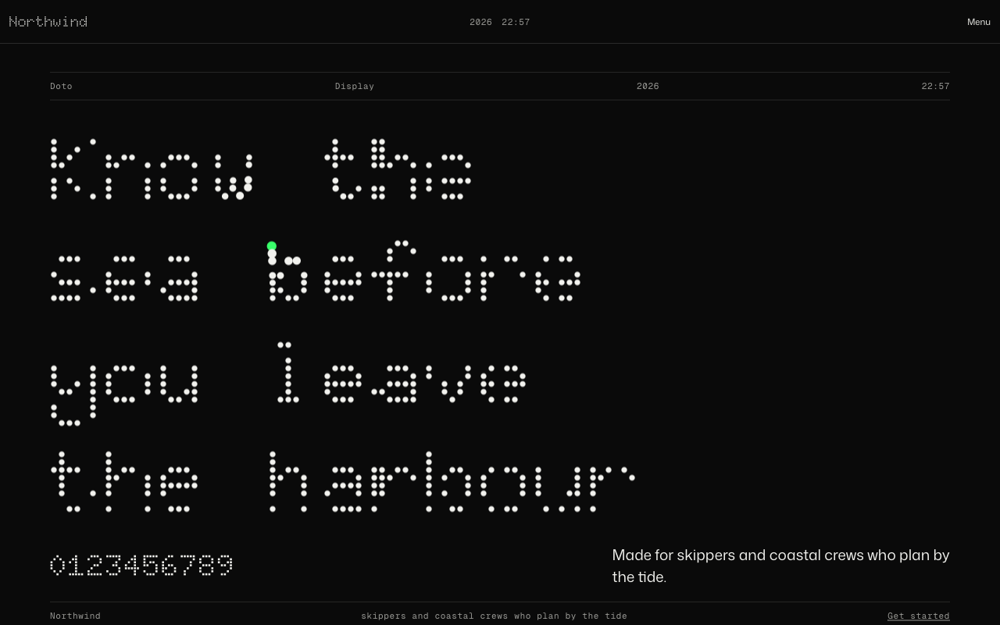
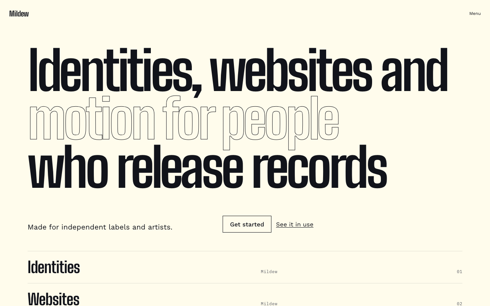
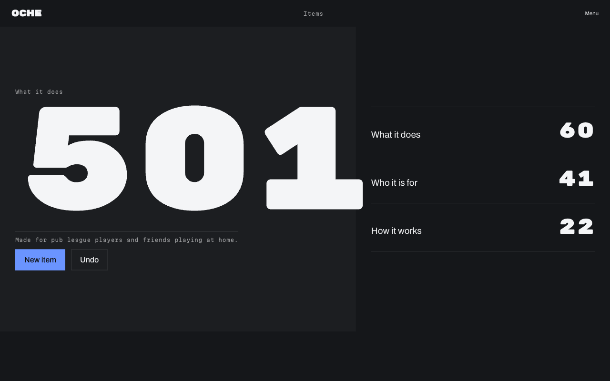

# preview-first

**Look before you build.** A Claude Code skill that shows you several complete web design directions in your browser, with real palettes, type, components, motion and device frames, before any application code is written. Pick one, and it becomes a design contract that every later Claude session follows.

[](https://github.com/moraneus/preview-first/actions/workflows/ci.yml)


[](LICENSE)


## What you get

Tell Claude what you are building. Within a minute a local page opens with three to eight directions, each a complete look and not a theme on a shared skeleton, and every page carries **Surprise me**, **Variations** and **Show all styles** so the set is never the limit:

- a first screen chosen for the kind of product (a scoreboard opens on the score, a shop on products, a developer tool on a terminal), drawn from 36 styles and 24 hero archetypes;
- a palette authored in OKLCH with every role contrast-checked in light and dark, a type pairing from Google Fonts chosen for character (dot-matrix and pixel faces, condensed display, variable grotesques, old-style serifs), and the components in every state;
- eight to twelve design ideas attached to each direction from a graph of 529 sourced moves: navigation devices, textures, type details, sections, imagery treatments and live behaviours (dot-matrix headlines that light up under the pointer, character reveals, decode effects, tickers that lean with scroll, pointer-reactive grids, artwork trails);
- the draft inside frames of the best-selling phones, foldables, tablets and laptops;
- copy written from your product's own nouns before the first open, and a page programme per direction, so no two drafts share a section order.

Select one, and Claude writes `design/DESIGN.md` with tokens (W3C Design Tokens, CSS, Tailwind v4) that later work follows.

|  |  |  |
|---|---|---|

Every template, as a contact sheet: [docs/templates.md](docs/templates.md).

## Install

Claude Code, two lines:

```
/plugin marketplace add moraneus/preview-first
/plugin install preview-first@preview-first
```

Any agent that reads skills (`npx skills add moraneus/preview-first`), or copy `skills/preview-first/` into your skills directory. Runtime is Python 3.9 or later, standard library only.

## How it works

1. Claude reads the repo and asks at most four questions: what the product is and for whom, three words for how it should feel, anything fixed (brand colour, font, light or dark), and which page matters most.
2. `quick_start.py` recommends directions from the knowledge graph, builds the preview and opens it. The gallery, tiles, drafts and device views are static HTML served from `.design-preview/`.
3. You compare, swap palette, type, radius, density and motion live, draw random directions, and select one. Claude refines copy while you look.
4. `export_design.py` writes the contract. Later sessions read it before touching UI.

```
.design-preview/   brief.json, directions.json, the built preview, selection.json
design/            DESIGN.md, tokens.json, tokens.css, tailwind.css, history/
```

## The knowledge graph

Decisions come from `skills/preview-first/knowledge/graph.json`: styles, palettes, type pairings, component treatments, motion patterns, product types with topic kits, moods, icon sets, platform features, reference sites, and design ideas with render hooks. Edges say what pairs with what, what suits which product and mood, and what to avoid. `validate_graph.py` checks every node and edge and fails any palette whose text does not reach WCAG 4.5:1 and APCA Lc 60 on its background in both modes. `refresh_knowledge.py` pulls Google Fonts, web-features Baseline data, release feeds and design feeds weekly.

The graph also records the tells of generated design (purple gradients, three icon cards, Inter by default, the italic serif accent word, scroll reveal on everything) as high-risk ideas that are never chosen unless a brief asks for them by name.

## Repository layout

```
skills/preview-first/   the skill: SKILL.md, references/, knowledge/, scripts/, assets/
tests/                  pytest suite
docs/                   templates gallery, research notes, design documents
tools/                  dev-only scripts that built the graph
```

## Contributing

Design ideas, palettes, pairings, devices and reference sites are the most useful contributions. See [CONTRIBUTING.md](CONTRIBUTING.md). Run the validator and the tests before opening a pull request:

```bash
python3 skills/preview-first/scripts/validate_graph.py
python3 -m pytest -q
```

## Licence

MIT. Icon samples are redistributed under their own licences (Lucide ISC; Phosphor, Heroicons, Tabler and Radix Icons MIT; Material Symbols Apache 2.0). Fonts load from Google Fonts under the Open Font License or Apache 2.0.
