# preview-first

**Look before you build.** A Claude Code skill that shows you three to five complete web design directions in your browser, with real colour palettes, typography, components, motion and device frames, before any application code is written. Pick one, and it becomes a design contract that every later Claude session follows.

[](https://github.com/moraneus/preview-first/actions/workflows/ci.yml)


[](LICENSE)

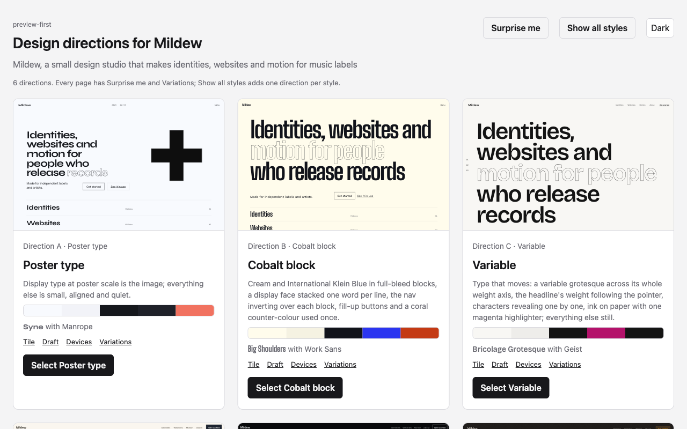

**Every template at a glance.** 31 styles, one brief, first screens only: [docs/templates.md](docs/templates.md).

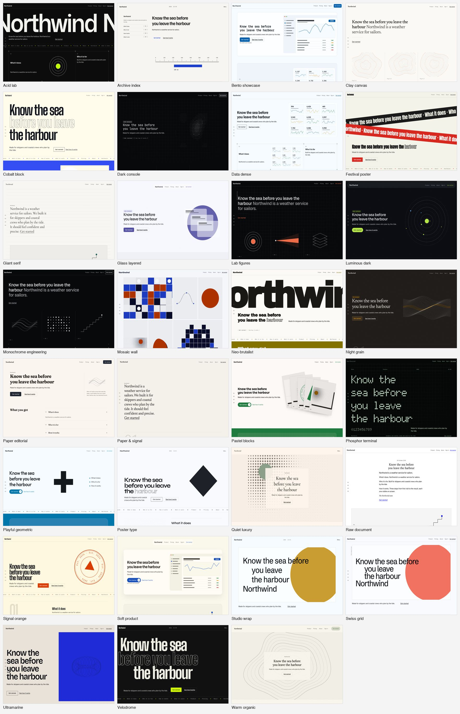

## Not the template

Generated sites share a page order before they share a colour: centred headline, two buttons, screenshot, three cards, logo bar, testimonials, footer. preview-first never opens a direction with it, and since 0.3.0 a direction is not a palette on a fixed skeleton either. Each one is a style plus eight to twelve **design ideas** drawn from a graph of 512 sourced moves observed on modern sites and templates: a split navigation with the studio's live local time, a specimen hero, giant numerals, a bordered grid with corner crosses, film grain, bracket buttons, a marquee of the product's real nouns, a colophon footer with the face in use and the version. Ideas with a render hook change the draft; the rest travel into the contract with their implementation notes and the sites they came from. No two directions in a set share a navigation device, a first screen or a texture.

| Acid lab: ticker hero, marquee, cells with crosses, bracket buttons | Archive index: index column, hover list, mono counts, colophon |
|---|---|
| 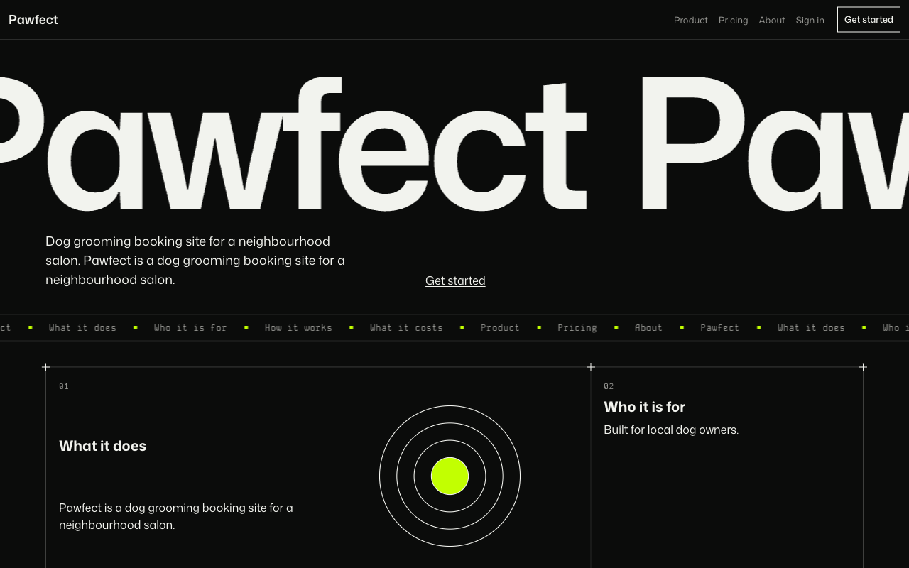 | 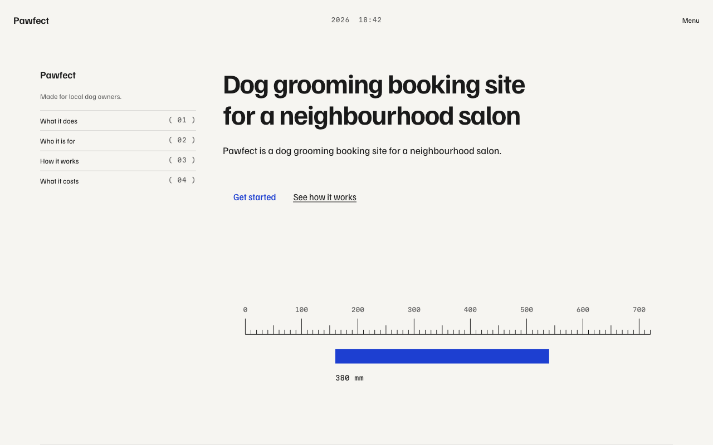 |

| Clay canvas: statement, captioned contour figures, hairline accordion | Night grain: warm black, serif display, strands, giant numerals |
|---|---|
| 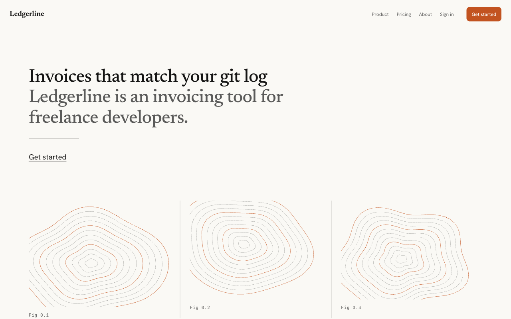 | 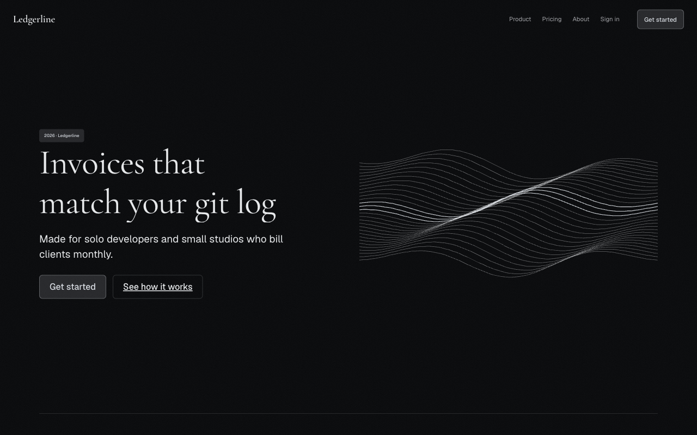 |

| Store: phosphor terminal with category tiles and object stand-ins | Content: broadsheet masthead, side notes, archive index | App: icon rail, ledger table, inspector |
|---|---|---|
| 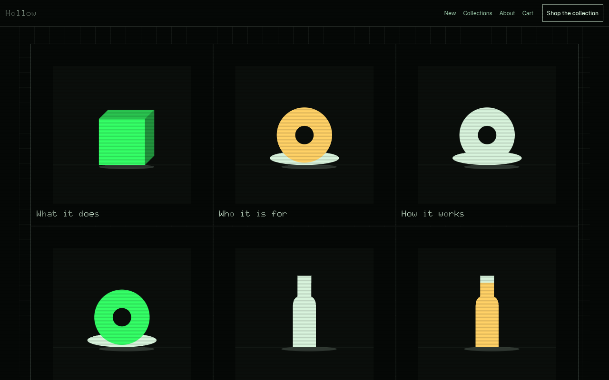 | 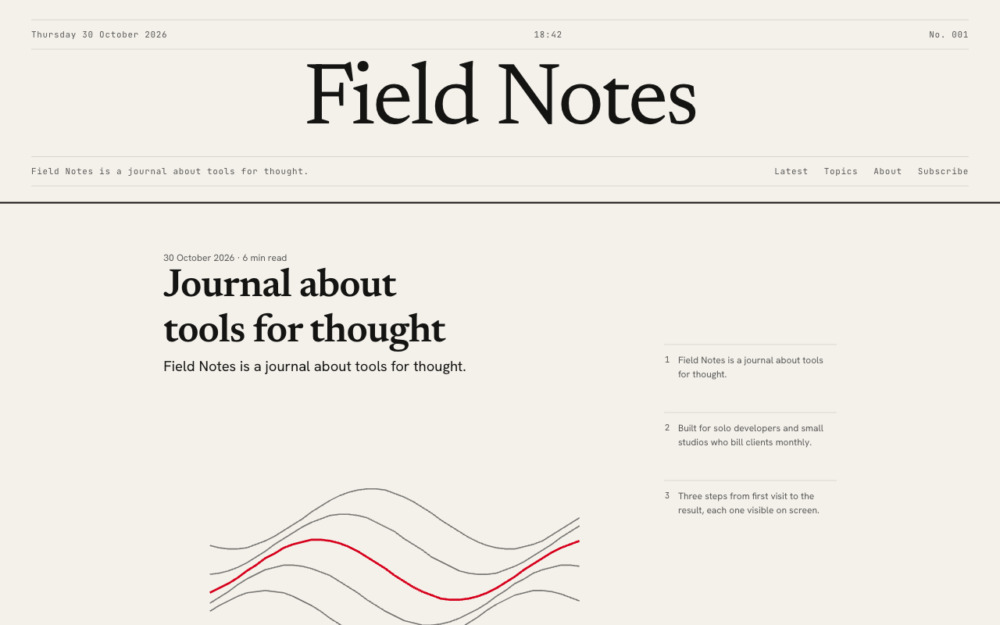 | 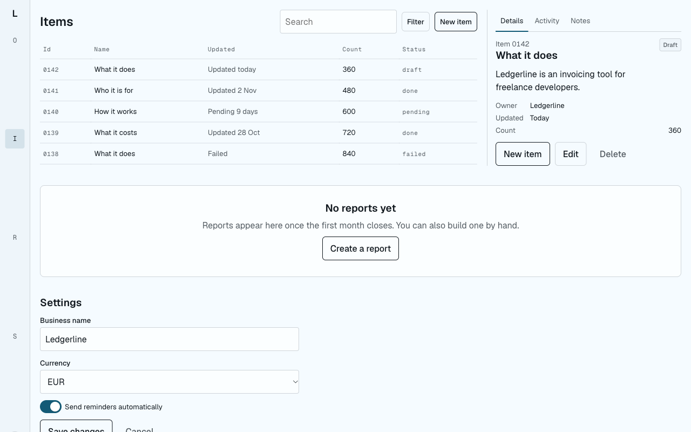 |

Every image on the page is artwork generated from the direction's own palette (36 generators: product window, terminal, blueprint, ASCII field, dithered light, flow field, strands, stamp, ruler, globe, specimen, pixel mark, oscilloscope, grained disc, ticket, object stand-ins and more), never a grey box with an icon. The exported contract records the archetype, the artwork and every idea so the real build keeps the composition.

## Why

When you ask an AI to build a website, it makes a hundred design decisions silently, one component at a time, and you find out what the site looks like after it exists. The result tends to look like every other generated site: the same purple gradient, the same three rounded cards, Inter everywhere.

preview-first puts a design studio stage in front of that. Claude reads your project, asks four short questions, and builds real HTML directions you can open, compare and tweak. Nothing is coded until you have chosen. Then the choice is written down, with tokens, so the code that follows stays on brief.

## What you see

| Style tile | Drafted page | Device frames |
|---|---|---|
| 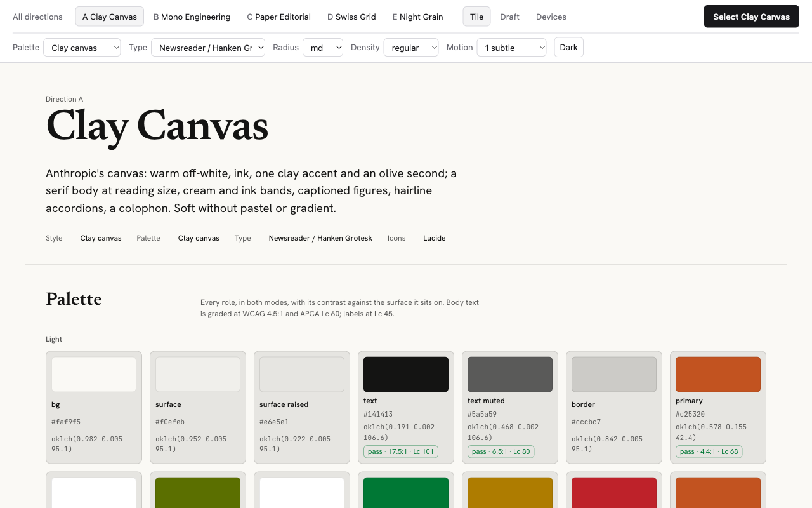 | 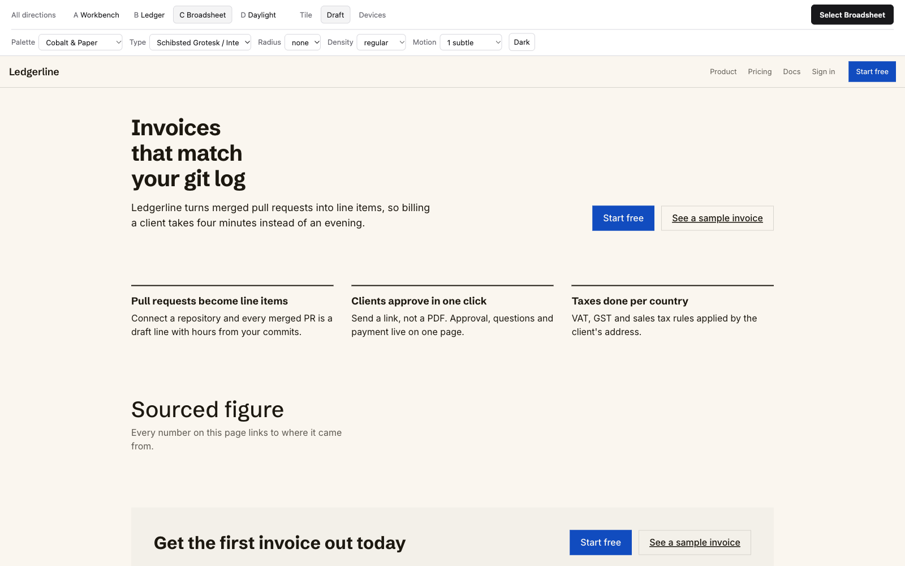 | 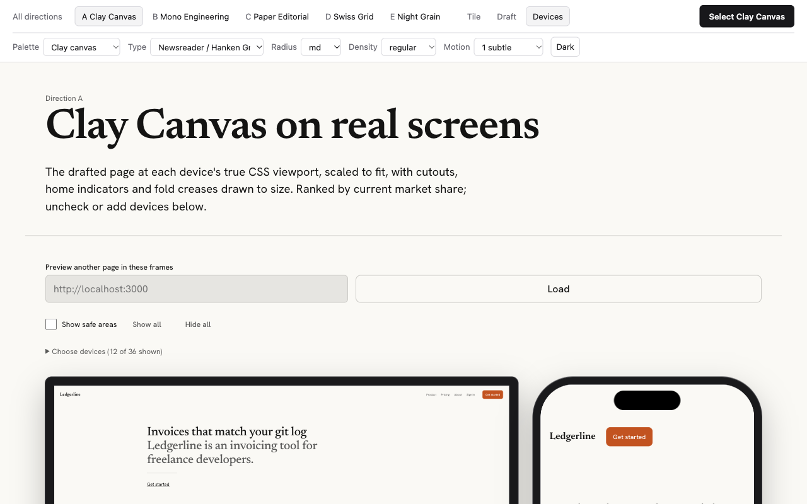 |

For each direction:

- **Palette** in both light and dark mode, authored in OKLCH, with WCAG and APCA contrast graded for every role.
- **Typography**: a real pairing loaded from Google Fonts, the scale from display to footnote, measure and leading, licence and fallback stacks.
- **Components**: buttons in six states, inputs in four, selects, switches, cards, badges, alerts, tabs, navigation and footer, drawn with the direction's own treatments.
- **Motion**: every allowed pattern playable on demand with its real duration and easing, plus a reduced-motion toggle.
- **A drafted page** for your page type (marketing, app, content or store), using your product's words, not lorem ipsum. 24 hero archetypes, 16 feature archetypes, five navigation devices and the ideas attached to the direction mean two directions are never the same template in new colours.
- **Devices**: the draft rendered at true viewport size inside CSS-drawn frames of the current best-selling phones, foldables, tablets and laptops, with Dynamic Island, punch holes, fold creases and safe areas. Point it at your running dev server later with `?url=`.

Swap palette, type pairing, radius, density, motion level and theme live on any page. Select, and Claude exports the contract.

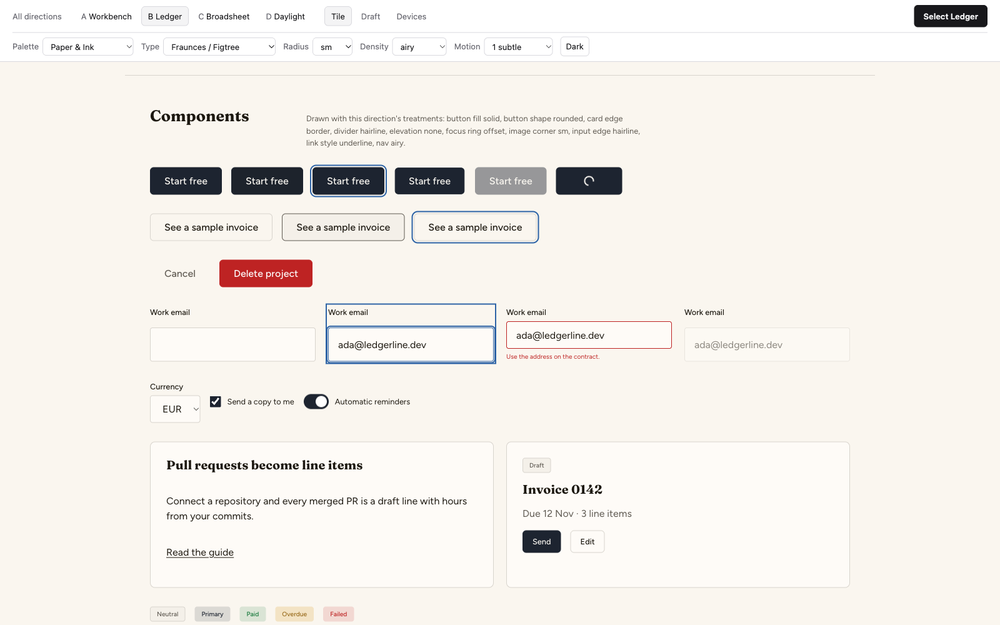

## Install

Claude Code, two lines:

```
/plugin marketplace add moraneus/preview-first
/plugin install preview-first@preview-first
```

Any agent that reads the open skill format:

```
npx skills add moraneus/preview-first
```

Manual: copy `skills/preview-first/` into `~/.claude/skills/` (or your agent's skills directory). The skill is standard-library Python 3.9 or newer plus static HTML; nothing to install.

<details>
<summary>Other agents and paths</summary>

| Agent | Project path | Global path |
|---|---|---|
| Claude Code | `.claude/skills/preview-first` | `~/.claude/skills/preview-first` |
| Cursor | `.agents/skills/preview-first` | `~/.cursor/skills/preview-first` |
| Codex | `.agents/skills/preview-first` | `~/.agents/skills/preview-first` |
| OpenCode | `.agents/skills/preview-first` | `~/.config/opencode/skills/preview-first` |
| Windsurf | `.windsurf/skills/preview-first` | `~/.codeium/windsurf/skills/preview-first` |
| Gemini CLI | `.agents/skills/preview-first` | `~/.agents/skills/preview-first` |

Only Claude Code is tested in this release. The scripts and preview run anywhere; the workflow in SKILL.md is written in agent-neutral terms.
</details>

## How it works

1. **Brief.** Claude reads the repo (framework, existing colours, fonts, logo) and asks at most four questions. The answers become `.design-preview/brief.json`.
2. **Directions.** `recommend.py` walks the knowledge graph and returns three to five bundles with enforced diversity: distinct style families, no shared palette, at most two of one colour temperature or type category. Claude names each direction, writes a rationale that quotes your brief, and writes the draft copy.
3. **Preview.** `build_preview.py` renders the gallery, tiles, drafts and device views; `serve_preview.py` opens them on localhost. Claude tells you the URL and waits. This is the checkpoint: nothing else happens until you choose.
4. **Select and tweak.** Swap palettes, pairings, radius, density and motion live. The Select button records your choice and the overrides you ended on.
5. **Contract.** `export_design.py` writes `design/DESIGN.md`, `design/tokens.json` (W3C Design Tokens), `design/tokens.css` and, for Tailwind v4 projects, `design/tailwind.css`, and adds one line to `CLAUDE.md` so every later session reads the contract first.
6. **Build to the contract.** Later UI work uses tokens, not raw values, keeps to the allowed motion, checks contrast on new colours, and can re-open the device frames on the real page.

## The contract

An excerpt of a generated `design/DESIGN.md`:

```markdown
## Palette

Palette **Paper & Ink** (warm, light). Authored in OKLCH, rendered to sRGB hex.

| Role | Light | Dark | OKLCH (light) | Use |
|---|---|---|---|---|
| bg | `#fcfaf6` | `#120f0c` | `oklch(0.985 0.006 85.0)` | Page background |
| text | `#1e1a16` | `#edebe7` | `oklch(0.220 0.010 60.0)` | Body and headings |
| primary | `#154d8c` | `#85b4f0` | `oklch(0.420 0.120 255.0)` | One primary action per view |

## Motion

Motion level: **1** (0 none, 1 subtle, 2 expressive, 3 showcase).

| Pattern | Trigger | Duration | Easing | Communicates |
|---|---|---|---|---|
| Press scale | press | 120ms | `ease` | The control is physical and responded |
| Enter fade up | enter | 240ms | `cubic-bezier(0.23, 1, 0.32, 1)` | Content arrived from below |

## Do not

- Cream canvas with terracotta accent.
- No indigo-to-purple gradients, gradient headline text or coloured glows as decoration.
- No emoji as icons or bullets; use the icon set named above.
```

Generated sections sit between markers; your own notes below them survive every re-export, and previous versions are kept in `design/history/`.

## The knowledge graph

Decisions come from `skills/preview-first/knowledge/graph.json`, a graph of what goes with what:

| Nodes | Count | Edges |
|---|---|---|
| Styles (31, from paper editorial and Swiss grid to acid lab, velodrome, festival poster, ultramarine, pastel blocks and mosaic wall) | 31 | `defaults_to` treatments and motion, `requires` platform features, `ideas` lists |
| Design ideas: sourced moves with a description, implementation note, tell risk, sites seen on and an optional render hook (76 hooks implemented in the drafts) | 512 | `pairs_with` styles, `suits` from product types, `expresses` from moods |
| Palettes, OKLCH, light and dark, every role contrast-checked | 65 | `pairs_with` and `avoid_with` styles |
| Type pairings with fallbacks, scale ratio, licence, loading URL; families verified against the Google Fonts snapshot | 68 | `pairs_with` and `avoid_with` styles |
| Component treatments (closed vocabulary across 10 axes) | 33 | |
| Layout archetypes (hero 24, features 16, proof 7, call to action 5, footer 4, nav 5, plus store, content and app variants) and artwork generators | 61 and 36 | chosen by `layout`, render hooks, then each style's `layout_defaults` and `art` |
| Motion patterns with trigger, duration, easing, reduced-motion rule | 26 | |
| Product types and moods with aliases | 22 and 20 | `suits` and `expresses` styles and ideas |
| Icon sets, platform features with Baseline status | 6 and 16 | |
| Reference sites, recorded as evidence on edges | 235 | cited by 2,296 edges |
| Devices with viewport, DPR, safe areas, cutout, share rank | 36 | |

Every node carries a source and dates. `validate_graph.py` checks the schema, every edge endpoint, and fails any palette whose text does not reach WCAG 4.5:1 and APCA Lc 60 on its background in both modes.

**Live refresh.** `refresh_knowledge.py` pulls Google Fonts popularity and trending ranks, web-features Baseline status, release feeds and npm downloads for Motion, GSAP, Tailwind, shadcn, Radix, Lucide and Phosphor, and nine design feeds, from machine-readable sources only. A weekly GitHub Action opens a pull request with the refreshed snapshot; the skill also refreshes into a user cache when the data is older than seven days.

## Not an AI website generator

preview-first does not write your application code. It produces a decision and a contract. The preview itself is built from a closed vocabulary of treatments and layout variants, checked against a list of the tells that make generated sites look generated (purple gradients, all-caps eyebrow labels, three identical cards, emoji icons, Inter by default, scroll-reveal on every section), and it refuses those unless your brief asks for them by name.

## Repository layout

```
skills/preview-first/   the skill: SKILL.md, references/, knowledge/, scripts/, assets/
tests/                  pytest suite (standard library under test)
docs/research/          the research that seeded the graph, with sources (the 2026-10-30 ideas sweep included)
tools/                  dev-only scripts that merged the research into the graph
docs/superpowers/       design document and implementation plan
.github/workflows/      ci.yml, refresh.yml
```

## Contributing

Design ideas with sources, palettes, pairings, devices and reference sites are the most useful contributions; see `skills/preview-first/references/ideas.md` for the idea shape and the render hooks. See [CONTRIBUTING.md](CONTRIBUTING.md). Run the validator and tests before opening a pull request:

```bash
python3 skills/preview-first/scripts/validate_graph.py
python3 -m pytest -q
```

## Licence

MIT. Icon samples are redistributed under their own licences (Lucide ISC; Phosphor, Heroicons, Tabler and Radix Icons MIT; Material Symbols Apache 2.0). Fonts load from Google Fonts under the Open Font License or Apache 2.0 unless a pairing says otherwise.
