# Every template

One brief (Northwind, a weather service for sailors), every style, the first screen at 1280 wide. Built with `tools/build_showcase.py`; each draft also exists for the app, content and store page types. Artwork is generated from each palette and stands in for real imagery.

## Acid lab

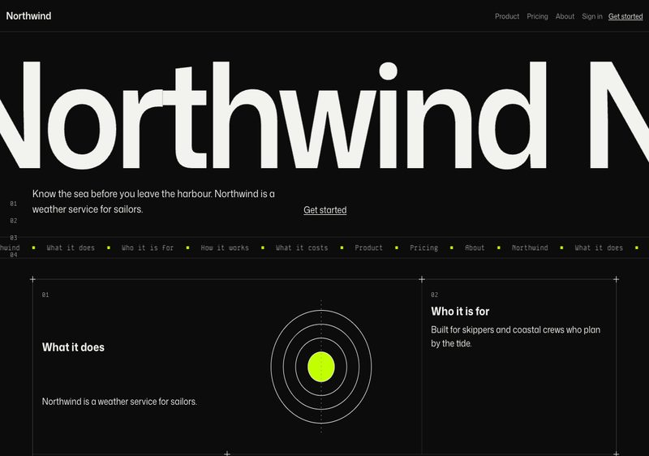

Black, off-white and one acid green on a visible grid; mono labels, bordered cells with corner crosses, a marquee of real nouns, dithered artwork.

- Family technical, distinct, radius none, density compact. Hero `ticker`, features `cells`, footer `colophon`. Artwork dither, figure.
- Ideas it always carries: one hot colour, bordered cells with corner crosses, marquee divider line, dithered imagery, bracket button, mono index numbers, colophon footer, tight display type.
- Inspired by: https://warp.dev, https://basement.studio, https://vercel.com/ship.

## Archive index

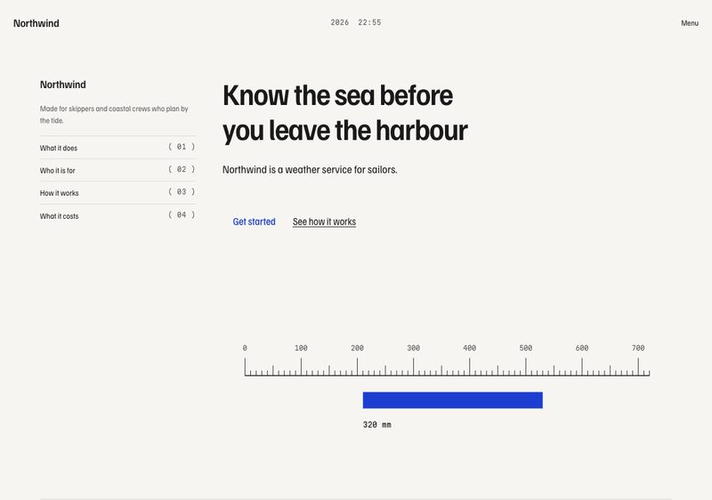

An index rather than a brochure: one grotesque, a wide mono for dates and counts, hover rows that reveal images, ledger lists, a colophon with the local time.

- Family minimal, distinct, radius none, density regular. Hero `index`, features `hover-list`, footer `colophon`. Artwork figure, ruler.
- Ideas it always carries: hover list with image reveal, mono index numbers, archive index list, colophon footer, offset underline links, tabular numerals everywhere, split nav with live metadata, editorial product grid.
- Inspired by: https://www.are.na, https://read.cv, https://klim.co.nz.

## Bento showcase

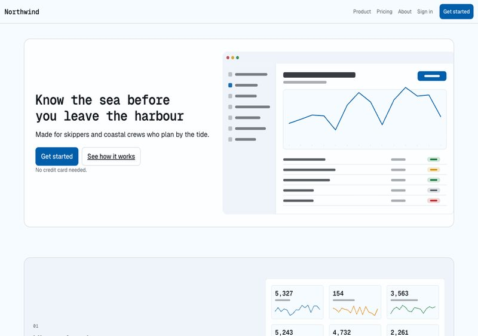

A grid of unequal cells, each showing one real product capability with a small mono caption.

- Family technical, familiar, radius md, density compact. Hero `product-first`, features `bento`, footer `columns`. Artwork sparklines, ui_mock.
- Ideas it always carries: bordered cells with corner crosses, count-up numerals, hover image swap, sticky stacking cards.
- Inspired by: https://linear.app/features.

## Clay canvas

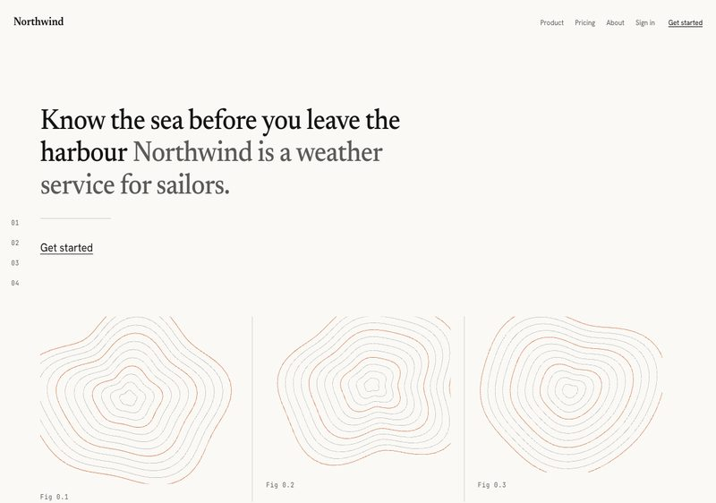

Anthropic's canvas: warm off-white, ink, one clay accent and an olive second; a serif body at reading size, cream and ink bands, captioned figures, hairline accordions, a colophon. Soft without pastel or gradient.

- Family soft, distinct, radius md, density regular. Hero `statement`, features `bands`, footer `colophon`. Artwork contours, grain_disc.
- Ideas it always carries: captioned figures, hairline accordion, one giant quote, inverted closing section, colophon footer, offset underline links, cross-page view transitions.
- Inspired by: https://www.anthropic.com, https://granola.ai, https://www.craft.do.

## Cobalt block

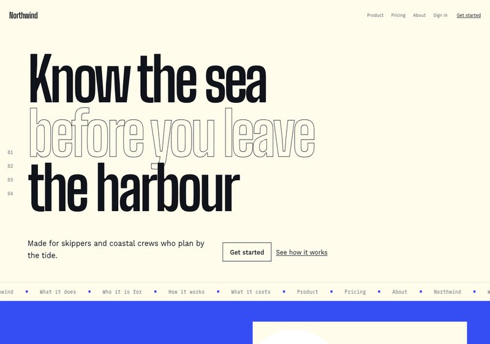

Cream and International Klein Blue in full-bleed blocks, a display face stacked one word per line, the nav inverting over each block, fill-up buttons and a coral counter-colour used once.

- Family expressive, distinct, radius none, density regular. Hero `stacked`, features `bands`, footer `giant`. Artwork mark, swiss.
- Ideas it always carries: colour-blocked sections, stacked words in alternating faces, fill-up hover button, marquee divider line, tight display type, inverted closing section, lookbook opening.
- Inspired by: https://arc.net, https://www.cos.com, https://www.polestar.com.

## Dark console

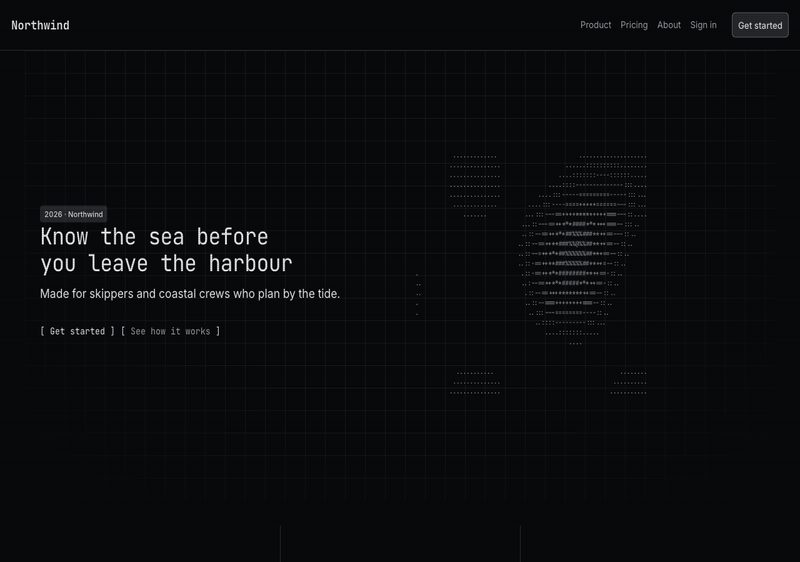

Near-black neutral surfaces, hairline borders, mono labels for data, one restrained accent; the look of a good terminal.

- Family dark, familiar, radius sm, density compact. Hero `object`, features `figures`, footer `giant`. Artwork figure, terminal.
- Ideas it always carries: scanlines, ascii field artwork, bracket button, graph paper grid, tabular numerals everywhere, scroll progress hairline.
- Inspired by: https://resend.com, https://warp.dev.

## Data dense

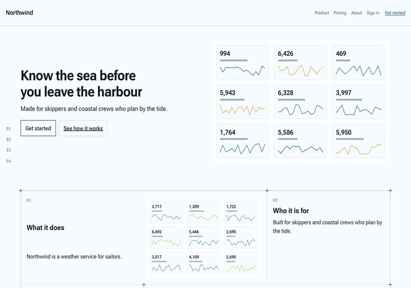

Tables first: tabular numerals, tight rows, sidebar navigation, colour reserved for status.

- Family technical, familiar, radius sm, density compact. Hero `split`, features `spec`, footer `columns`. Artwork sparklines.
- Ideas it always carries: tabular numerals everywhere, bordered cells with corner crosses, numbered index rail, stat wall, scroll progress hairline.
- Inspired by: https://www.metabase.com.

## Festival poster

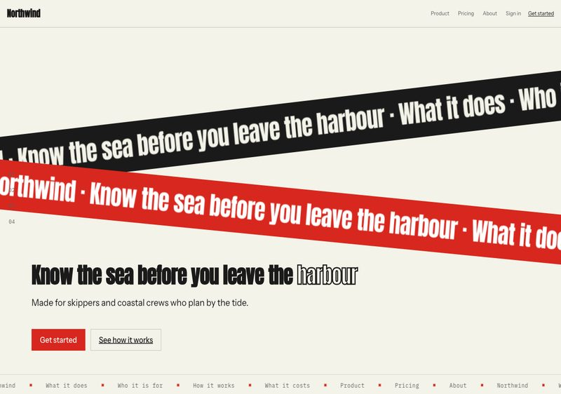

Bone white, signal red and mustard; a heavy condensed gothic; diagonal marquee bands crossing the hero; rays and stamps as artwork; a ticket for the call to action. Loud, flat, printed.

- Family expressive, distinct, radius none, density regular. Hero `diagonal`, features `mosaic`, footer `giant`. Artwork rays, stamp.
- Ideas it always carries: diagonal marquee bands, image mosaic features, ticket call to action, rotated stickers, outlined giant word, colour-blocked sections, skewed marquee, marquee divider line.
- Inspired by: https://dontboardme.com, https://www.walkerart.org.

## Giant serif

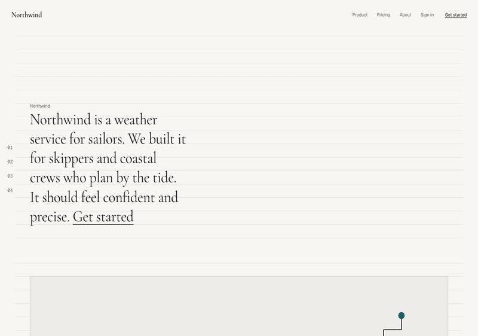

A serif at ten rem and above as the whole image, a letter or manifesto as the first screen, side notes, hanging punctuation, warm stone white and one deep link colour; built for words.

- Family editorial, distinct, radius none, density airy. Hero `letter`, features `ledger`, footer `colophon`. Artwork contours, figure.
- Ideas it always carries: manifesto hero, hanging punctuation, one giant quote, side notes column, archive index list, captioned figures, colophon footer, offset underline links.
- Inspired by: https://arc.net, https://asteriskmag.com, https://www.noemamag.com.

## Glass layered

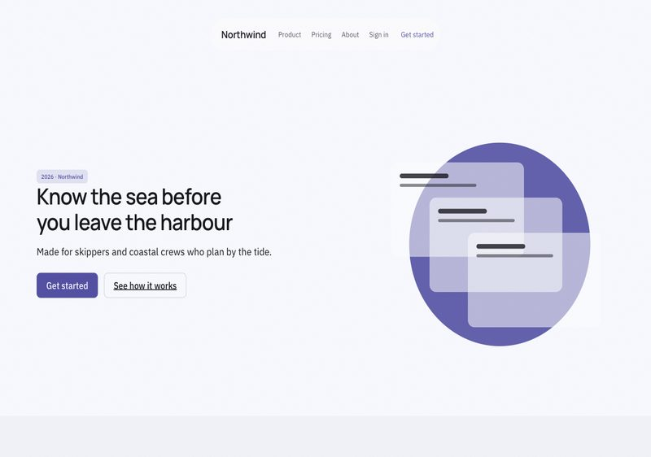

Translucent panels over a coloured field, blur used only where a surface really floats over content.

- Family expressive, familiar, radius md, density regular. Hero `object`, features `bands`, footer `columns`. Artwork glass, orbit.
- Ideas it always carries: floating pill nav, film grain overlay, line mask reveal, stat wall.
- Inspired by: https://www.raycast.com.

## Lab figures

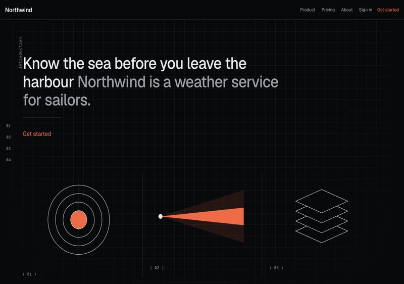

Near-black lab notebook: line-art isometric figures with mono captions (Fig 0.1), a two-tone statement paragraph instead of a headline and buttons, hairline column rules.

- Family technical, distinct, radius sm, density regular. Hero `statement`, features `figures`, footer `giant`. Artwork figure, isometric.
- Ideas it always carries: captioned figures, graph paper grid, vertical side labels, mono index numbers, giant numerals index, tabular numerals everywhere.
- Inspired by: https://linear.app.

## Luminous dark

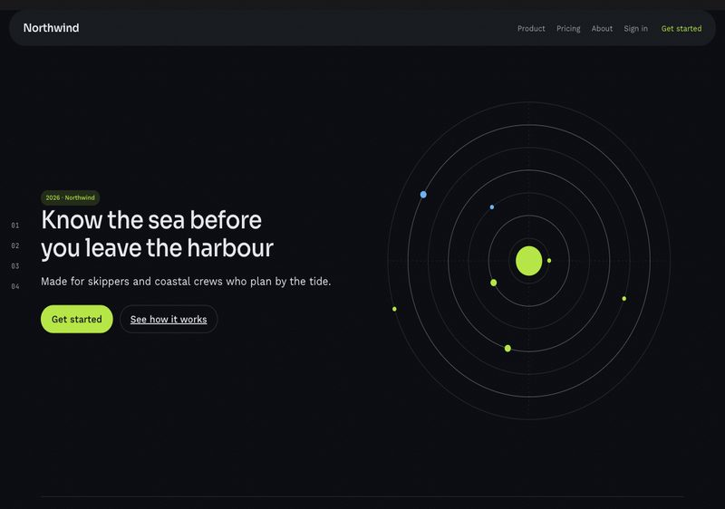

Dark canvas with one glowing hue, blurred gradient light, glassy raised panels and product imagery doing the talking.

- Family dark, familiar, radius md, density regular. Hero `object`, features `bands`, footer `columns`. Artwork glass, orbit.
- Ideas it always carries: film grain overlay, line mask reveal, stat wall, giant numerals index, colophon footer.
- Inspired by: https://resend.com.

## Monochrome engineering

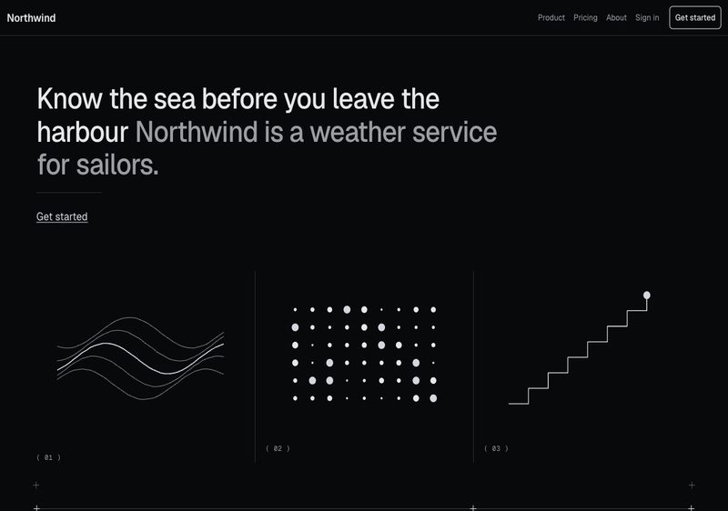

Greys with colour only where it means something, one sans for everything and mono for code, borders that are earned.

- Family technical, familiar, radius sm, density compact. Hero `statement`, features `figures`, footer `columns`. Artwork blueprint, figure.
- Ideas it always carries: graph paper grid, crosses at grid intersections, mono index numbers, bracket button, captioned figures, tabular numerals everywhere.
- Inspired by: https://linear.app, https://vercel.com/design.md.

## Mosaic wall

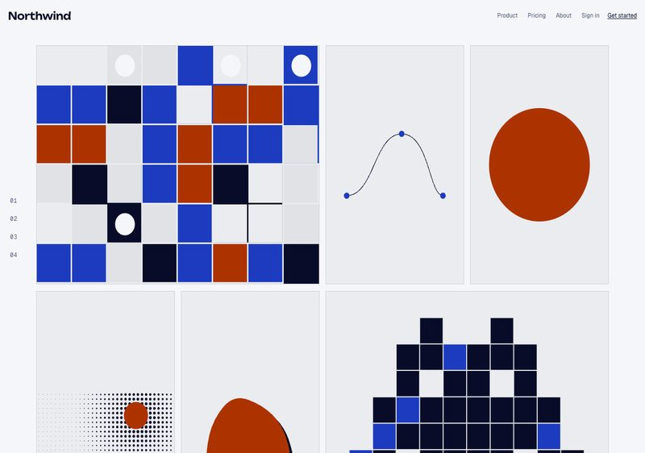

A poster wall: the first screen is a mosaic of tiles with the text as one dark tile, mosaic features, a wide display face, a marine palette with a coral counter; image-led from the first pixel.

- Family expressive, distinct, radius none, density regular. Hero `mosaic`, features `mosaic`, footer `giant`. Artwork figure, mosaic.
- Ideas it always carries: mosaic hero, image mosaic features, one hot colour, tight display type, poster band, mono index numbers, hover image swap.
- Inspired by: https://www.pentagram.com, https://maven.com.

## Neo-brutalist

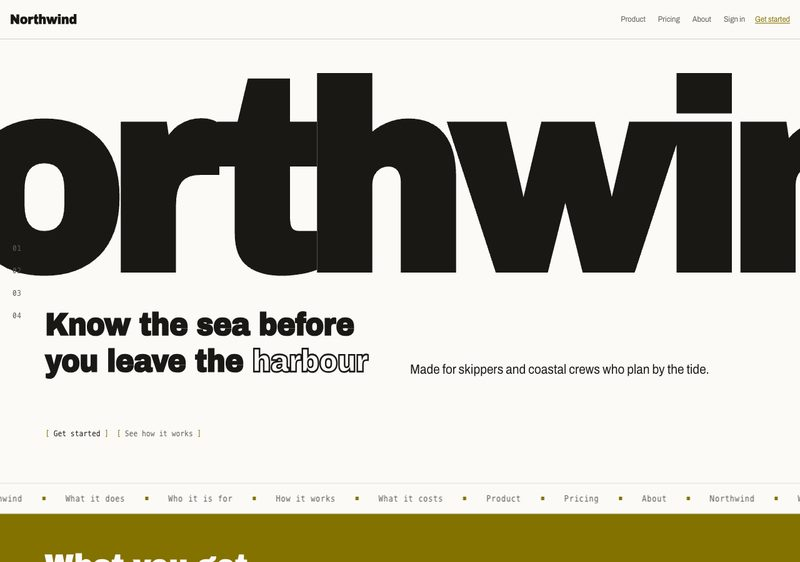

Flat saturated fills, thick dark borders, hard offset shadows, raw grotesque type; deliberately unpolished.

- Family bold, distinct, radius none, density regular. Hero `poster`, features `bands`, footer `giant`. Artwork halftone, stickers.
- Ideas it always carries: rotated stickers, marquee divider line, outlined giant word, bracket button, colour-blocked sections, type larger than the viewport.
- Inspired by: https://posthog.com, https://gumroad.com.

## Night grain

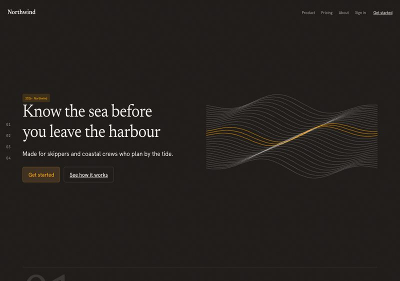

Warm near-black with film grain, a serif display at scale, one amber accent, strands of generated line art, a single giant quote and a colophon; dark without the blue glow.

- Family dark, distinct, radius sm, density regular. Hero `object`, features `numerals`, footer `colophon`. Artwork figure, strands.
- Ideas it always carries: film grain overlay, one giant quote, giant numerals index, colophon footer, line mask reveal, tabular numerals everywhere, mono index numbers.
- Inspired by: https://resend.com, https://warp.dev, https://www.raycast.com.

## Paper editorial

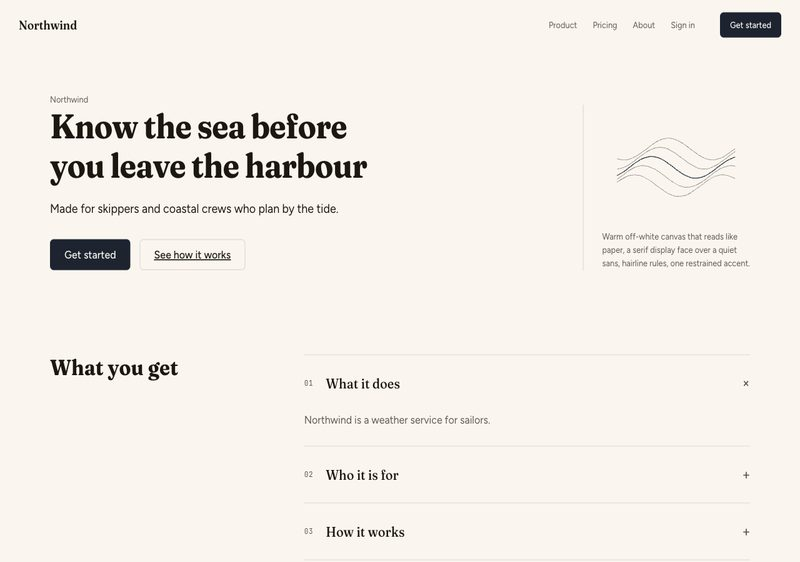

Warm off-white canvas that reads like paper, a serif display face over a quiet sans, hairline rules, one restrained accent.

- Family editorial, distinct, radius sm, density airy. Hero `editorial`, features `index`, footer `columns`. Artwork contours, figure.
- Ideas it always carries: mono index numbers, captioned figures, hairline accordion, one giant quote, hanging punctuation, colophon footer.
- Inspired by: https://www.anthropic.com, https://granola.ai.

## Paper & signal

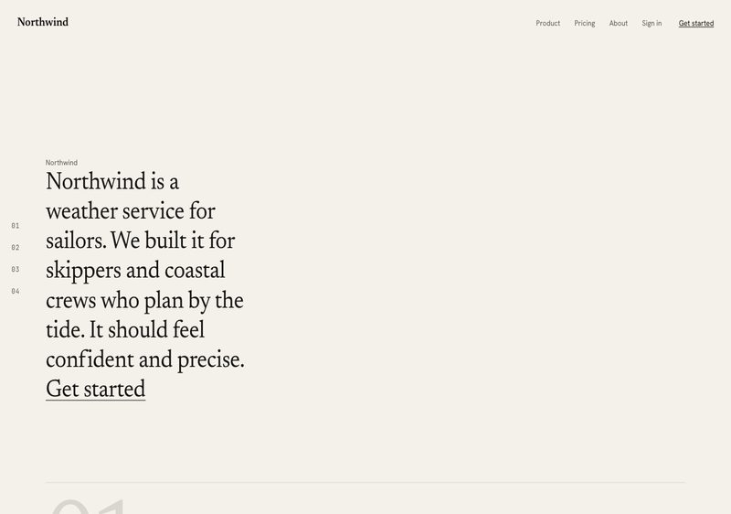

Warm paper, a transitional serif at broadsheet scale, hairline rules, signal red on one rule and one word; dates, issue numbers and archive lists everywhere.

- Family editorial, distinct, radius none, density airy. Hero `manifesto`, features `numerals`, footer `colophon`. Artwork contours, figure.
- Ideas it always carries: broadsheet masthead, one hot colour, giant numerals index, one giant quote, archive index list, hanging punctuation, captioned figures, colophon footer.
- Inspired by: https://press.stripe.com, https://www.lrb.co.uk, https://worksinprogress.co.

## Pastel blocks

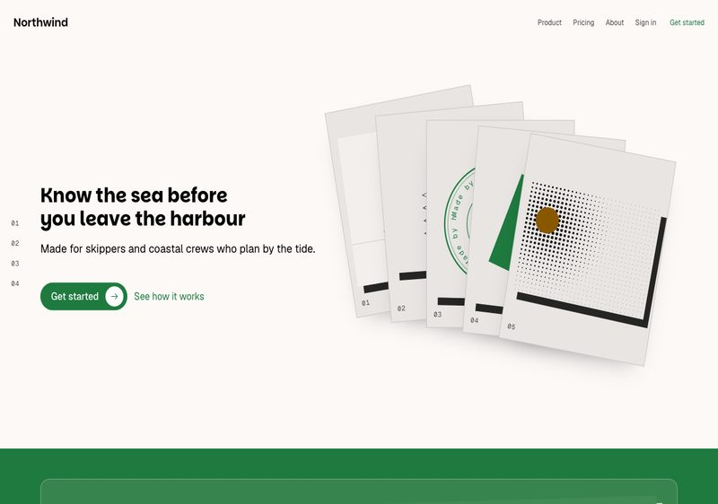

Craft and Figma's tinted blocks: a warm canvas, sections in mint, butter and sky with hard edges, a geometric display with soft terminals, fanned cards, tilted framed images and stickers. Playful without a gradient.

- Family soft, distinct, radius md, density regular. Hero `fan`, features `stack`, footer `columns`. Artwork blob, figure.
- Ideas it always carries: fanned cards hero, tilted framed images, colour-blocked sections, rotated stickers, sticky stacking cards, count-up numerals, pill with circled icon.
- Inspired by: https://www.craft.do, https://www.figma.com, https://brilliant.org.

## Phosphor terminal

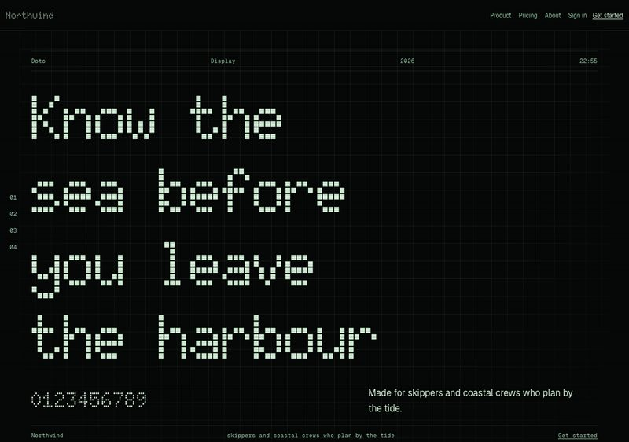

Black glass, phosphor green, a dot-matrix display face for the one big line, mono everywhere else, scanlines, ASCII artwork and bracket buttons; hardware and terminal brands.

- Family technical, distinct, radius none, density compact. Hero `specimen`, features `spec`, footer `colophon`. Artwork ascii, figure.
- Ideas it always carries: scanlines, ascii field artwork, bracket button, ticket call to action, tabular numerals everywhere, colophon footer, graph paper grid, command palette first.
- Inspired by: https://teenage.engineering, https://ghostty.org, https://play.date.

## Playful geometric

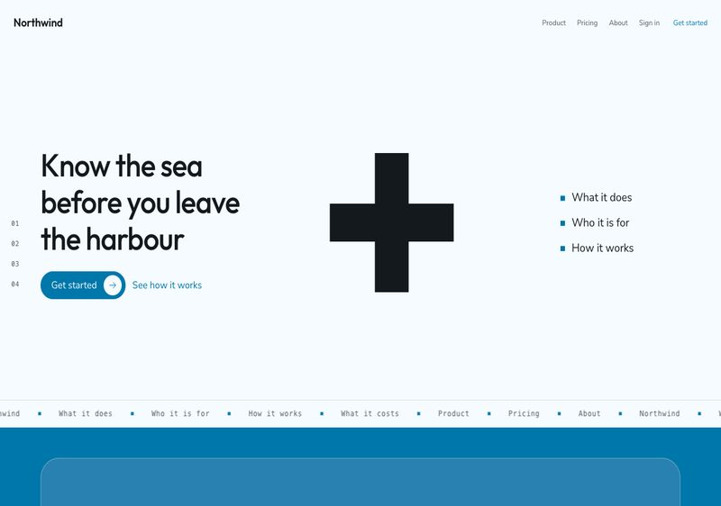

Bright flat colour blocks, geometric shapes, pill everything, bouncy motion; made to be liked.

- Family expressive, distinct, radius pill, density regular. Hero `mark`, features `bands`, footer `columns`. Artwork mark, swiss.
- Ideas it always carries: colour-blocked sections, pill with circled icon, sticky stacking cards, marquee divider line, count-up numerals.
- Inspired by: https://www.figma.com.

## Poster type

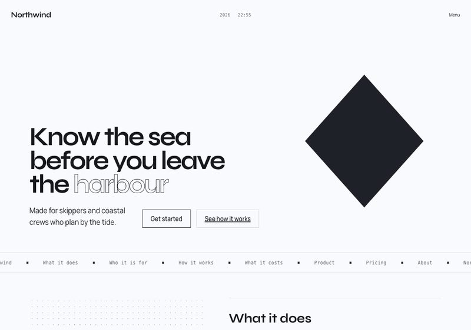

Display type at poster scale is the image; everything else is small, aligned and quiet.

- Family bold, distinct, radius none, density airy. Hero `poster`, features `index`, footer `giant`. Artwork halftone, mark.
- Ideas it always carries: tight display type, outlined giant word, marquee divider line, split nav with live metadata, preloader counter, line mask reveal.
- Inspired by: https://lusion.co, https://basement.studio.

## Quiet luxury

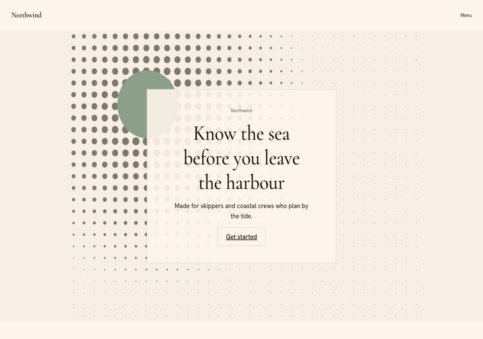

Generous space, a refined serif, muted low-chroma palette, square corners and almost no chrome.

- Family editorial, distinct, radius none, density airy. Hero `bleed`, features `index`, footer `minimal`. Artwork halftone, mark.
- Ideas it always carries: menu word and full-screen overlay, hairline accordion, one giant quote, inverted closing section, hover image swap, hanging punctuation.
- Inspired by: https://www.aesop.com.

## Raw document

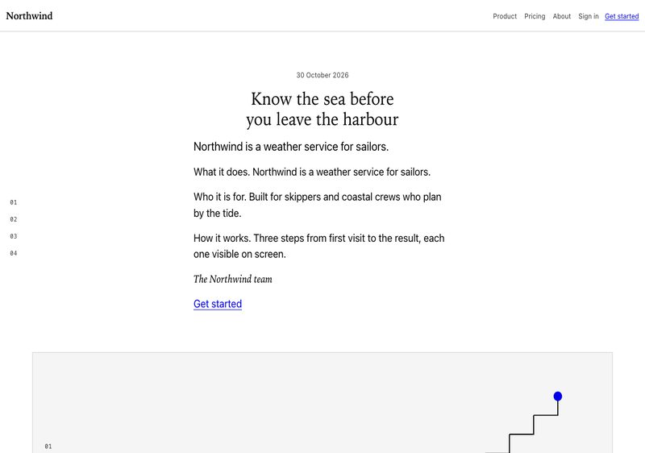

A web page that admits it is a document: system serif, default link blue, visible borders, tables, no cards, no shadows, square buttons with brackets; honest to the point of style.

- Family bold, distinct, radius none, density compact. Hero `letter`, features `spec`, footer `minimal`. Artwork figure, ruler.
- Ideas it always carries: bracket button, tabular numerals everywhere, offset underline links, captioned figures, ledger table, colophon footer.
- Inspired by: https://craigmod.com, https://berkeleygraphics.com, https://100r.co.

## Signal orange

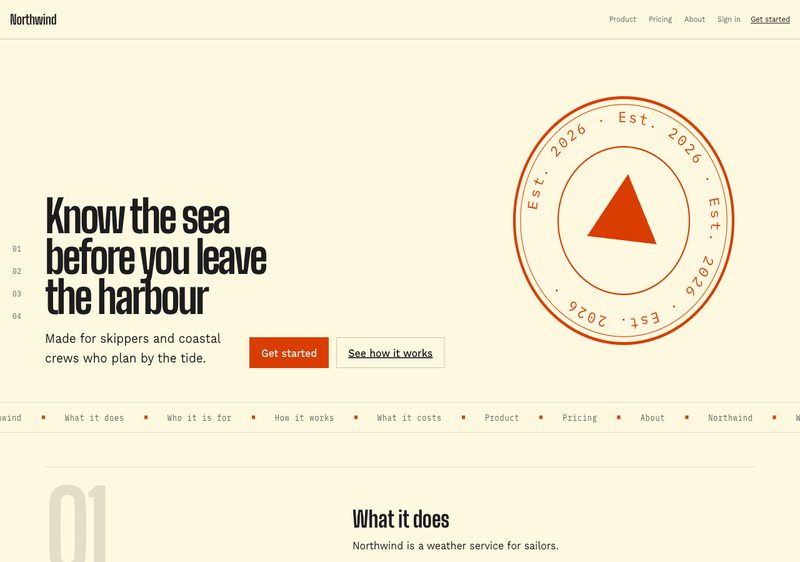

Cream, warm black and a sunset orange used hard: a condensed display face, stickers with true words, a stat wall of sourced figures, a ticket call to action, flat everywhere.

- Family expressive, distinct, radius sm, density regular. Hero `poster`, features `numerals`, footer `giant`. Artwork stamp, swiss.
- Ideas it always carries: one hot colour, rotated stickers, stat wall, ticket call to action, count-up numerals, marquee divider line, tight display type.
- Inspired by: https://mistral.ai, https://cursor.com, https://liquiddeath.com.

## Soft product

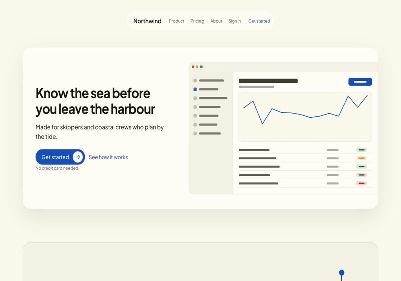

Friendly product UI: large radius, soft layered shadows, a clear primary, airy cards, pill buttons.

- Family soft, familiar, radius lg, density regular. Hero `product-first`, features `bands`, footer `columns`. Artwork figure, ui_mock.
- Ideas it always carries: floating pill nav, sticky stacking cards, pill with circled icon, count-up numerals, stat wall.
- Inspired by: https://cal.com.

## Studio wrap

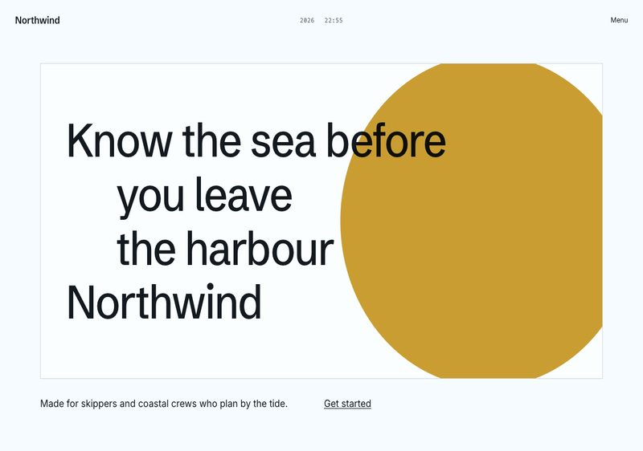

A pale neutral canvas, one giant grotesque headline with alternating indents wrapping a single flat disc of saturated colour, square corners, almost no chrome; a designer's own site, not a product template.

- Family expressive, distinct, radius none, density airy. Hero `wrap`, features `index`, footer `giant`. Artwork figure, mark.
- Ideas it always carries: split nav with live metadata, hover list with image reveal, colophon footer, custom cursor dot and ring, mono index numbers, line mask reveal.
- Inspired by: https://rauno.me, https://paco.me.

## Swiss grid

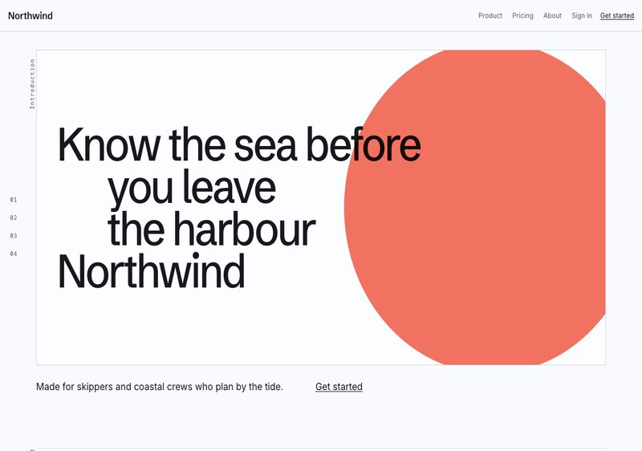

Black, white and one accent on a visible grid; type does the work, nothing is decorated.

- Family minimal, distinct, radius none, density regular. Hero `wrap`, features `spec`, footer `minimal`. Artwork mark, swiss.
- Ideas it always carries: bordered cells with corner crosses, giant numerals index, tight display type, fill-up hover button, one hot colour, vertical side labels.
- Inspired by: https://rauno.me, https://vercel.com.

## Ultramarine

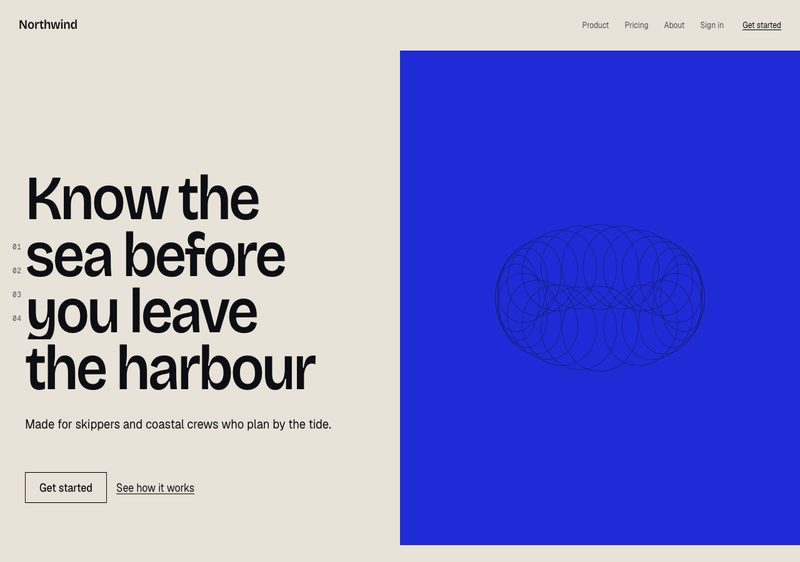

Exo Ape's sand and deep ultramarine, a hairline-weight display face, a split-screen first screen with the artwork on a solid blue panel, a torus of rings, mosaic features and a colophon. Architectural calm.

- Family minimal, distinct, radius none, density airy. Hero `split-screen`, features `mosaic`, footer `colophon`. Artwork figure, torus.
- Ideas it always carries: split-screen hero, image mosaic features, tight display type, colophon footer, line mask reveal, hero art scales out, mono index numbers, offset underline links.
- Inspired by: https://exo-ape.com, https://www.polestar.com.

## Velodrome

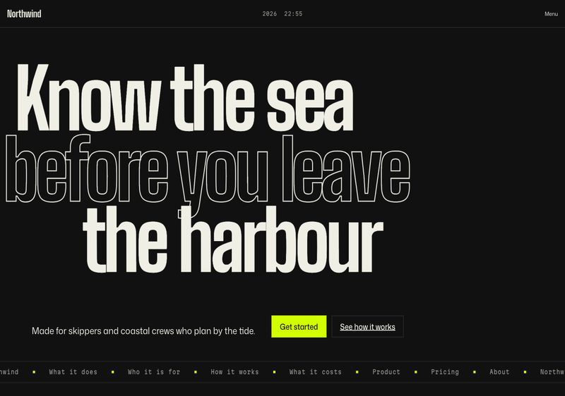

Lando Norris energy: near-black, lime and cream, a condensed display face at 900, kinetic type that slides with scroll, a marquee, a poster band and sourced count-ups. Speed as a design language.

- Family bold, distinct, radius none, density regular. Hero `kinetic`, features `numerals`, footer `giant`. Artwork bars, figure.
- Ideas it always carries: kinetic type hero, one hot colour, marquee divider line, poster band, count-up numerals, tight display type, parallax giant word, split nav with live metadata.
- Inspired by: https://www.landonorris.com, https://basement.studio.

## Warm organic

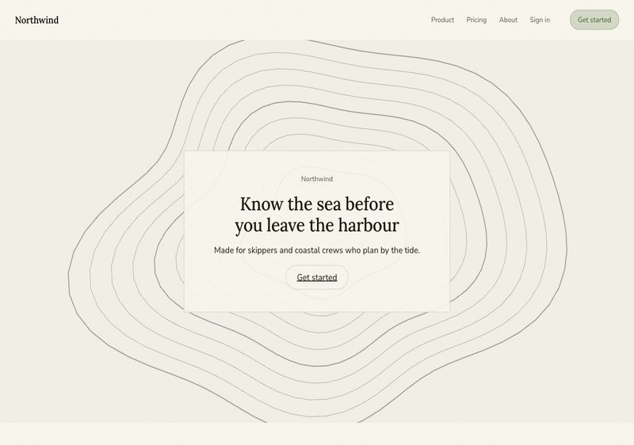

Earth tones, rounded forms, generous line height, photography with large radius; calm and human.

- Family soft, distinct, radius lg, density airy. Hero `bleed`, features `alternating`, footer `minimal`. Artwork contours.
- Ideas it always carries: film grain overlay, hairline accordion, captioned figures, duotone imagery, one giant quote.
- Inspired by: https://www.headspace.com.
